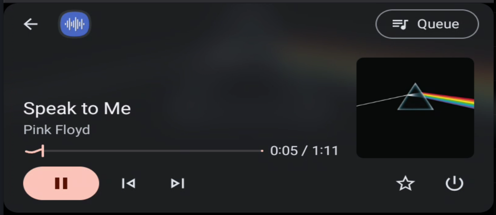
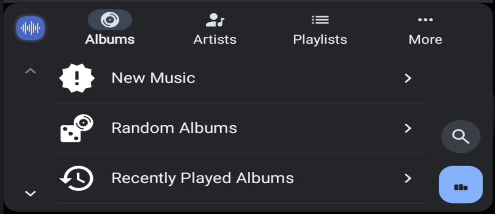

# Introduction
This is an Android-app that can act as a controller of a Lyrion Music Server (LMS), allowing you to play audio on any player connected to the LMS server; it can also be setup as a phone-centric music player used to browse and play content in your phone, when used in combination with the [squeezelite](https://github.com/arigit/squeezelite) app that needs to be installed in the phone as well for local (in-phone) playback.

It includes a fully-featured android-auto (in-car) interface, this is the key difference with the excellent [CDrummond/lms-material-app](https://github.com/CDrummond/lms-material-app). It builds upon the great work done by [chrober/lms-material-app](https://github.com/chrober/lms-material-app/tree/feature/android-auto) but changes the focus of the Android Auto support from 
"in-car server" to remote (in-home) server streaming, that would be your Lyrion server at home, with your phone reaching it over cellular + VPN / Tailscale.

Modifications to the upstream lms-material and squeezelite android apps run a bit deep as I found that almost invariably, after connecting the phone to the car and accessing the LMS app UI, Playback will fail, for different reasons, typically related to squeezelite not running, or running but not started, or wrong player selected (so the kitchen speaker would start playing after turning on the car :), or wrong library view etc. Extensive changes done to ensure the primary phone-centric use case "just works" when you get in the car.

I also implemented changes in squeezelite, the largest is related to buffering: we have larger buffer options and "next song" buffering as well. This is meant to avoid cuts due to short cellular coverage gaps; I tested this extensively during long commutes, streaming 24/96 and 24/192 original FLAC music with excellent results. It is possible to setup squeezelite to have server-side mp3 transcoding (I haven't tested that).

The development of this fork has been done entirely by Claude Code. While I made all the decisions, all the car testing and a lot of debugging, the code development and the changes are entirely AI. 

I hope that the changes can be merged back to the original repo ([CDrummond/lms-material-app](https://github.com/CDrummond/lms-material-app) and this repo eventually shelved. 

## Requirements
Two apps are required, pick the latest releases of both:
- https://github.com/arigit/squeezelite/releases
- https://github.com/arigit/lms-material-app/releases

The APKs need a recent android platform and need to be side-loaded after enabling 

## Key New Features
This fork build on the work done by upstream adding:

- optimized for **in-car playback of a remote music collection**: your music stays on your Lyrion Music Server at home, and the phone streams it to the car through Android Auto over cellular 

- tries to provide a 'just works' solution for LMS users:  assumes by default that you will use a local player squeezelite player in the phone auto-starts it, can be setup to auto-resume queue playback upon connection

- it supports in-car queue management (add to queue) 

- it supports and exposes shuffle mode in the car UI

- it exposes track ratings and allows setting of track ratings via the car UI (this requires the ratings-light LMS plugin in your server)

- 

- When the car connects, it starts Squeezelite, selects the phone's player and switches it on; Power in the car (re)starts the player if it has stopped.
- Browse your library from the car: albums (new, random, recently played, A-Z with letter jumps), artists, playlists, favourites, and switch libraries and players.
- See and pick from the play queue, and rate tracks (Ratings Light).
- Pauses for another media app (e.g. a podcast) started in the car.

It is a separate app (`com.craigd.lmsmaterial.app.ar`, shown on the phone and in Android Auto as "Lyrion (ar)"), so it installs alongside the original.

This fork was developed with heavy use of AI (Claude Code): the changes were designed, written and tested with an AI assistant, and checked in the car and with Android Auto's Desktop Head Unit. The car version gets almost daily testing.

Once this fork's code has proven fully stable, the plan is to propose merging it upstream (see the upstream sources above).

 

## Install

1. From the latest [release](https://github.com/arigit/lms-material-app/releases/latest), download both `Lyrion-ar-*.apk` and its player `Squeezelite-ar-*.apk` (also published on its own in [Squeezelite (ar) releases](https://github.com/arigit/squeezelite/releases)), and install both (allow installing from your browser or file manager when Android asks).
2. Open **Squeezelite (ar)**, set the LMS server, and start the player once.
3. Open **Lyrion (ar)**, connect to the same LMS server, and in **Settings** set **Player app** to **Squeezelite (ar)**. For the car, also turn on **Auto-start player**, and set the phone's player as the **Default player** (with **Only control default** if only the phone should be controlled).
4. Android Auto only lists apps that aren't from the Play Store once you allow it: open Android Auto's settings on the phone, tap **Version** repeatedly until developer mode is enabled, then in the ⋮ menu → **Developer settings** turn on **Unknown sources**.
5. Connect to the car and pick **Lyrion (ar)** from the Android Auto launcher. Android Auto remembers it as your media app from then on.

Updates are installed the same way, over the existing app (settings are kept). The release APKs are signed with the fork's own key, so they can't replace an app installed from F-Droid or another build.

More details on testing, including with the Desktop Head Unit: [Squeezelite (ar) docs/android-auto.md](https://github.com/arigit/squeezelite/blob/master/docs/android-auto.md).
 
 [](https://f-droid.org/packages/com.craigd.lmsmaterial.app/) 
[](https://apt.izzysoft.de/packages/com.craigd.lmsmaterial.app)
 
# Building and signing the app

You can build the app using your own signing key. Only signed apk files can be
installed by downloading, so the signing process is required. 

Read this documentation for details: https://developer.android.com/studio/publish/app-signing

* create a jsk keystore and a key for signing app:
```
keytool -genkey -v -keystore my-release-key.jks -keyalg RSA -keysize 2048 -validity 10000 -alias my-alias
```
* create file keystore.properties:
```
storePassword=myStorePassword
keyPassword=mykeyPassword
keyAlias=my-alias
storeFile=my-release-key.jks
```
* secure this file:
```
chmod 600 keystore.properties
```
* build release apk:
```
./gradlew assembleRelease
```
* move release artifact to your phone: 
```
/lms-material-app/lms-material/build/outputs/apk/release/lms-material-release.apk 
```

# Donations

I develop this skin purely for fun, so no donations are required. However, seeing as I have been asked about this a few times, here is a link...

[](https://www.paypal.com/cgi-bin/webscr?cmd=_s-xclick&hosted_button_id=2X2CTDUH27V9L&source=url)

# Licenses

This app is provided under the [MIT License](LICENSE).

The metadata in the `fastlane/metadata/android` directory is used by F-Droid but stored in this repository for convenience.  Much of it was taken from F-Droid, and it is hence provided under the [GNU Affero General Public License](fastlane/metadata/android/LICENSE).
